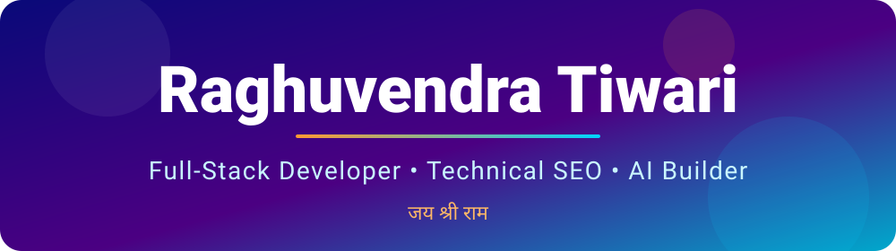
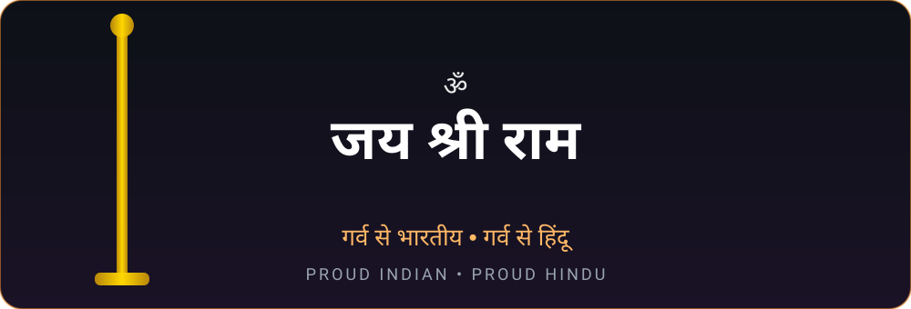

 

  

 

---

## 👨‍💻 About Me

Main **Raghuvendra Tiwari** hoon. Full-stack development, technical SEO aur AI ko jodkar aise digital products banata hoon jo dekhne mein sundar hon aur chalne mein tez. Code ke saath-saath apni community aur apne businesses bhi build kar raha hoon.

<table>
<tr>
<td width="50%" valign="top">

### 🚀 What I Do
- 💻 Full-stack web applications
- 🔍 Technical SEO & Core Web Vitals
- 🤖 AI & LLM-powered tools
- 📣 Social media marketing
- 🎮 Esports community & tournaments

</td>
<td width="50%" valign="top">

### 🌱 Mindset
- 🔭 Scalable, production-grade builds
- ⚡ Speed, performance, clean code
- 🧠 Always learning, always shipping
- 🎯 **Learn. Build. Improve. Repeat.**

</td>
</tr>
</table>

---

## 🏢 My Ventures

<table>
<tr>
<td width="50%" valign="top">

### 📣 Social Media Marketing Agency
Brands ko online grow karne ke liye marketing, SEO aur web solutions.

🔗 **[devloperwala.in](https://devloperwala.in)**

</td>
<td width="50%" valign="top">

### 🎮 Sports Community & Tournaments
Indian esports players aur organisations ke liye community aur tournaments.

🔗 **[ygesports.devloperwala.in](https://ygesports.devloperwala.in)**

</td>
</tr>
</table>

---

## 🔨 Currently Building

| # | Project | What it is |
|:-:|---------|------------|
| 1 | 🏢 **HRMS Portal** | Complete HR management portal for organisations |
| 2 | 👕 **Clothing Store** | Fashion e-commerce store, built from scratch |
| 3 | 📱 **Android Screen-Capture App** | Production-grade app for cheat-free gaming: gameplay is recorded purely via screen capture, with offline support |

---

## 🛠️ Tech Stack

 

 

<table>
<tr><th>Layer</th><th>Technologies</th></tr>
<tr><td>🎨 Frontend</td><td>React • Tailwind CSS • Bootstrap • HTML • CSS</td></tr>
<tr><td>⚙️ Backend</td><td>Node.js • Express.js • Django • Flask • PHP</td></tr>
<tr><td>🗄️ Databases</td><td>MySQL • MongoDB • PostgreSQL</td></tr>
<tr><td>🔧 Tools</td><td>Git • GitHub • VS Code • Postman</td></tr>
</table>

---

## 🔍 Technical SEO & Analytics

<b>👉 Areas of expertise (click to expand)</b>

 

- Technical SEO audits
- Website speed optimization
- Core Web Vitals
- On-page SEO
- Search engine indexing
- Website architecture
- Structured data & schema markup

---

## 🤖 AI & Emerging Tech

<b>👉 What I'm exploring (click to expand)</b>

 

- AI-powered applications
- Large Language Models (LLMs)
- AI API integrations
- Intelligent automation
- AI-assisted development

---

## 📊 GitHub Activity

---

## 📬 Let's Connect

Kisi project, collaboration ya idea par baat karni ho to bas ek message door hoon.

<table>
<tr>
<td align="center" width="50%">
<a href="https://devloperwala.in"><b>🌐 Agency</b></a> 
<a href="https://devloperwala.in">devloperwala.in</a>
</td>
<td align="center" width="50%">
<a href="https://ygesports.devloperwala.in"><b>🎮 Esports</b></a> 
<a href="https://ygesports.devloperwala.in">ygesports.devloperwala.in</a>
</td>
</tr>
<tr>
<td align="center">
<a href="https://www.instagram.com/officialjackshukla"><b>📸 Instagram</b></a> 
<a href="https://www.instagram.com/officialjackshukla">@officialjackshukla</a>
</td>
<td align="center">
<a href="https://www.linkedin.com/in/raghuvendra-tiwari-a73826314/"><b>💼 LinkedIn</b></a> 
<a href="https://www.linkedin.com/in/raghuvendra-tiwari-a73826314/">Raghuvendra Tiwari</a>
</td>
</tr>
<tr>
<td align="center">
<a href="https://wa.me/918956662703"><b>📱 WhatsApp</b></a> 
<a href="https://wa.me/918956662703">+91 89566 62703</a>
</td>
<td align="center">
<a href="https://x.com/RaghavPandit_G"><b>🐦 X (Twitter)</b></a> 
<a href="https://x.com/RaghavPandit_G">@RaghavPandit_G</a>
</td>
</tr>
<tr>
<td align="center" colspan="2">
<a href="mailto:younggolenesports@gmail.com"><b>📧 Email</b></a> 
<a href="mailto:younggolenesports@gmail.com">younggolenesports@gmail.com</a>
</td>
</tr>
</table>

 

### 🙏 Thank You for Visiting!
*Profile dekhne ke liye shukriya. Milte hain next build mein.*

💡 "Great things are built one line of code at a time."

  

